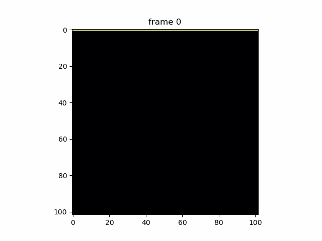
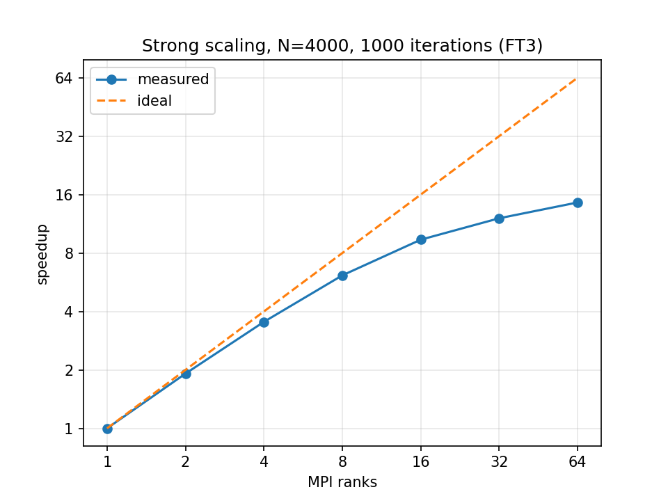
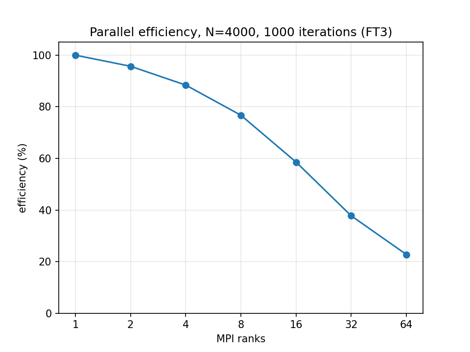

# 2D Heat Solver (C + MPI)

A 2D steady-state heat solver in C, written first in serial and then in parallel with MPI, and tested for strong scaling on the FT3 supercomputer (CESGA).



## The problem

A square plate with the top edge held at 100 and the other three edges at 0. The heat equation is discretized with a 5-point stencil and solved with Jacobi iteration: each inner point becomes the average of its 4 neighbors, until the largest change in one iteration is below a tolerance (1e-4).

## How it works

- **Serial (`heat_serial.c`):** flat 1D array of size (N+2)×(N+2) with a ring of fixed edge cells, two arrays with a pointer swap each iteration.
- **MPI (`heat_mpi.c`):**
  - the N inner rows are split into strips, one per rank (leftover rows spread over the first ranks)
  - each strip has one halo row above and below, filled each iteration with two `MPI_Sendrecv` calls
  - `MPI_PROC_NULL` for the top and bottom ranks, so the plate edges need no special case
  - `MPI_Allreduce` (MAX) so all ranks stop at the same iteration
  - `MPI_Gatherv` collects the full grid on rank 0 for output

## Build and run

```bash
# serial
cc -O2 -Wall heat_serial.c -o heat_serial -lm
mkdir -p snaps
./heat_serial 100 1            # N, save snapshots (0/1)

# MPI
mpicc -O2 -Wall heat_mpi.c -o heat_mpi -lm
mpirun -np 4 ./heat_mpi 100 1  # N, save output (0/1), optional max_iter

# plots
python3 plot.py data.txt       # final grid
python3 animate.py             # GIF from snaps/
python3 scaling.py run.out     # scaling table and plots from a Slurm output file
```

On FT3: `sbatch scaling_ft3.sh` runs 1 to 64 ranks, 3 times each.

## Correctness

The MPI result is identical to the serial result (`diff` of the output files is empty) for 1, 3, 4 and 6 ranks, at N = 100 and N = 400. The iteration count is also the same (10,910 at N = 100, 82,266 at N = 400).

## Strong scaling on FT3

N = 4000, 1000 iterations, one FT3 node, Intel MPI 2021.3, best of 3 runs.

| ranks | time (s) | speedup | efficiency |
|---|---|---|---|
| 1 | 28.30 | 1.0 | 100% |
| 2 | 14.79 | 1.9 | 96% |
| 4 | 8.00 | 3.5 | 88% |
| 8 | 4.61 | 6.1 | 77% |
| 16 | 3.02 | 9.4 | 59% |
| 32 | 2.34 | 12.1 | 38% |
| 64 | 1.94 | 14.6 | 23% |

 

**Why it stops scaling:** the Jacobi update does only 4 small math operations per point but moves about 24 bytes of memory, so it is limited by memory bandwidth, not by compute. One rank runs at about 0.57 billion updates/s (about 14 GB/s). With 64 ranks, the node reaches about 8.2 billion updates/s (about 200 GB/s), close to what a full node's memory can deliver. Adding more cores does not help once the memory is saturated. Communication is small in comparison: each rank sends only two rows (32 KB) per iteration.

## Next steps

- check convergence every k iterations instead of every iteration
- overlap the halo exchange with computation (`MPI_Isend`/`MPI_Irecv`)
- 2D domain split with `MPI_Cart_create`